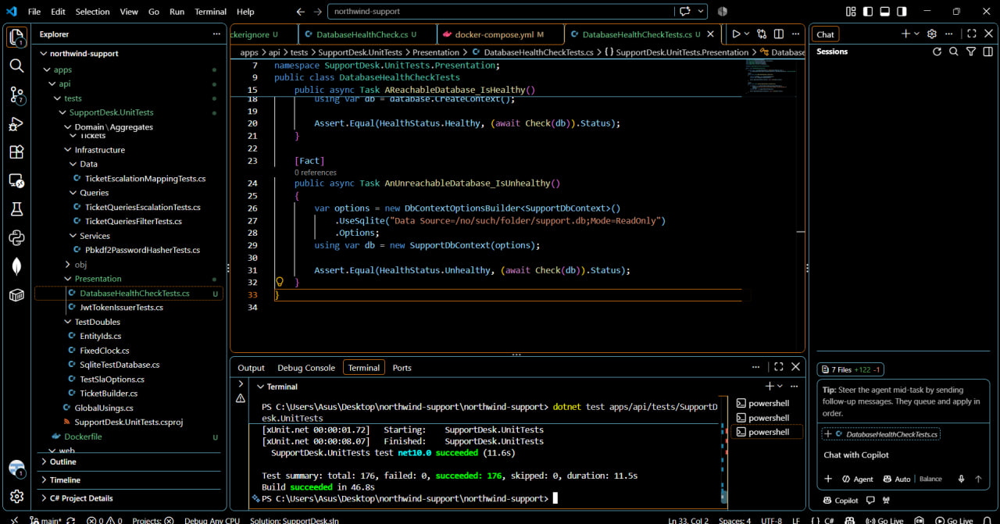

# Northwind Support Desk

A support ticket management system for creating, searching, filtering, assigning, escalating, and tracking support tickets.

**Tech Stack:** .NET 10 Web API, React 19, TypeScript, SQL Server, Entity Framework Core, JWT authentication, and Docker.

## 1. Implementation Summary

| Task | Implementation |
|---|---|
| Task 1 | Fixed DEFECT-117 and implemented server-side ticket filtering |
| Task 2 | Ticket triage, agent assignment, SLA calculation, escalation, and history |
| Task 3 | Agent login, JWT authentication, protected API endpoints, and frontend session handling |
| Task 4 | Multi-stage Docker build, non-root runtime, Docker Compose, and health endpoint |
| Task 2.5 | Optional SLA summary report not implemented |

## 2. Running the Application

### Prerequisites

- .NET 10 SDK
- Node.js 20 or later
- Docker Desktop
- Git

### Local Development

Run these commands from the repository root:

```bash
cp .env.example .env
npm install
npm run db:up
npm run api
npm run web
```

On Windows PowerShell, use `Copy-Item .env.example .env` instead of `cp` if needed.

| Service | Address |
|---|---|
| Frontend | http://localhost:5173 |
| API | http://localhost:5043 |
| SQL Server | localhost:1433 |

If the frontend proxy cannot connect to the API, configure `apps/web/.env.local`:

```env
VITE_API_PROXY_TARGET=http://localhost:5043
```

Restart the frontend after changing the configuration.

### Docker

Ensure Docker Desktop is running. From the repository root:

```bash
cp .env.example .env
docker compose up --build
```

Configure `MSSQL_SA_PASSWORD` and `Jwt__Key` using suitable development values. Do not commit real secrets.

The API is exposed at:

- API: http://localhost:5080
- Health endpoint: http://localhost:5080/health

To run the frontend against the containerized API:

```bash
VITE_API_PROXY_TARGET=http://localhost:5080 npm run web
```

## 3. Task 1 — Defect Fix and Server-Side Filtering

### DEFECT-117: Root Cause and Fix

The ticket-list effect in `useTicketList` did not include all filter values in its dependency list. As a result, changing a filter such as Status did not immediately trigger a new request. Changing the search value later could trigger a request with the updated filters, making the behaviour inconsistent.

The fix adds the relevant filter values to the effect dependencies. Search remains debounced to avoid sending a request for every keystroke. A regression test verifies that changing a filter triggers a request without requiring a search change.

### Server-Side Filtering

Filtering is implemented in `TicketQueries`. Filter predicates are composed before counting and pagination.

Supported filters include:

- Status, priority, category, and customer
- Assigned agent and unassigned tickets
- Search by ticket title, reference, and customer name
- Derived SLA status

Supplied filters combine using AND. Search values are trimmed, and blank search values are ignored. The filtered query is used to calculate `totalCount` and pagination metadata.

Tests cover priority matching, combined filters, and customer-name search. The SLA query uses SQL Server-specific `EF.Functions.DateDiffSecond` functionality and requires verification against SQL Server because SQLite cannot translate it in the same way.

## 4. Task 2 — Triage, Escalation, and SLA

### Business Rules

- Medium is the default priority when no priority is supplied.
- Security and Outage categories can force Critical priority.
- Base SLA windows are Critical: 4 hours, High: 8 hours, Medium: 24 hours, and Low: 72 hours.
- Premium customers receive half the SLA window, subject to a one-hour minimum.
- Billing, Outage, and Security tickets require appropriately specialised agents.
- Only active agents below their maximum open-ticket capacity are eligible.
- The eligible agent with the fewest open tickets is selected, with deterministic tie-breaking.
- If no agent is eligible, the ticket remains unassigned with an explanation.
- Escalation increases priority by one level, recalculates the due date from the escalation time, and retains the current agent only if still eligible.
- Critical, Resolved, and Closed tickets cannot be escalated.
- Escalation reasons must contain 5–500 characters.

SLA windows, the premium multiplier, the minimum window, and the at-risk threshold are configurable through the existing `Sla` configuration section. Category flags are used instead of hard-coded category names.

### API Behaviour

- `POST /api/tickets` creates a ticket and returns its triage decision, including priority, assignment, due date, SLA status, and reasons.
- `POST /api/tickets/{id}/escalate` escalates an eligible ticket and records the change.
- `GET /api/tickets/{id}/escalations` returns escalation history, newest first.
- `GET /api/tickets?slaStatus=...` filters tickets by derived SLA status.

Escalation history records the previous and new priority, agent, and due date, along with the reason, actor, and timestamp. The `TicketEscalations` table is introduced through an EF Core migration and has an index on `TicketId`.

SLA status is calculated when a ticket is read rather than stored. The evaluator distinguishes `NotApplicable`, `Met`, `Breached`, `AtRisk`, and `WithinSla`. An injectable clock makes time-dependent rules testable.

The frontend includes SLA indicators and filtering, an escalation panel, reason validation, pending and error states, escalation history, and the triage response after ticket creation.

## 5. Design Decisions

Business rules are kept in small, testable units rather than placing all logic in API handlers.

| Component | Responsibility |
|---|---|
| `Category.ResolvePriority` | Resolve priority from category rules |
| `SlaCalculator` | Calculate SLA due dates |
| `Agent.CanTake` | Check agent eligibility |
| `AgentSelector` | Select or retain an eligible agent |
| `Ticket.PriorityAfterEscalation` | Determine the next priority |
| `Ticket.ApplyEscalation` | Apply escalation changes |
| `SlaEvaluator` | Evaluate SLA status using an injected time |

Command handlers coordinate entity loading, domain logic, and persistence. This allows ticket creation and escalation to reuse the same rules.

Server-side filtering uses query composition so filters, counts, and pagination remain in SQL. A generic rules engine was not introduced because the current requirements can be handled by focused domain classes without additional complexity.

Password hashes are stored on the existing `Agents` entity because the system authenticates agents and does not require a separate user model. Escalation history is stored separately to preserve an auditable record of each escalation.

## 6. Task 3 — Authentication

The application uses JWT-based authentication.

- Agent passwords are stored as salted PBKDF2 hashes, not plain text.
- The `AddAgentPasswordHash` migration adds a nullable `PasswordHash` field to `Agents`.
- `POST /api/auth/login` returns a JWT, its expiry, and user information.
- Incorrect credentials and inactive accounts are rejected.
- `GET /api/auth/me` returns the authenticated user.
- A fallback authorization policy protects endpoints centrally, with required public endpoints explicitly excluded.
- The escalation actor is taken from the authenticated token rather than trusted from the request body.
- The frontend attaches the bearer token to API calls and redirects unauthenticated users to login.
- A 401 response clears the session and redirects to login.

The JWT lifetime is eight hours. The signing key is supplied through `Jwt__Key` configuration and must not be committed to source control.

### Development Login

| Field | Value |
|---|---|
| Email | `alex.turner@northwind-support.example` |
| Password | `LocalDevOnly!1` |
| Status | Active development account |

This is a development-only fixture account. Do not reuse these credentials in production.

The frontend stores the session in memory and localStorage under `northwind.session`. This supports page refreshes, but JavaScript executing through an XSS vulnerability could access the stored token.

For production, I would use managed secret storage, HTTPS, login rate limiting, and a reviewed token and session strategy.

## 7. Task 4 — Docker

The API Dockerfile is located at `apps/api/Dockerfile` and is built from the repository root.

The multi-stage build uses the .NET 10 SDK image to restore, build, and publish the API, followed by an ASP.NET runtime image. Dependency files are copied before the remaining source to allow the restore layer to be cached when dependencies have not changed.

The API is configured to run as a non-root user on port `8080`. Docker Compose exposes it at `localhost:5080` and connects it to SQL Server through the Compose service network. The API waits for SQL Server's health check before starting.

On an empty development database, the application applies migrations and seeds demonstration data. In production, migrations should run as a controlled deployment step rather than having every application instance attempt schema changes at startup.

The `/health` endpoint checks database reachability and is available without authentication.

### Docker Verification Evidence


Before submission, verify the following commands against the actual environment:

```bash
docker compose down -v
docker compose up --build
docker compose exec api whoami
docker images
```

Confirm that the API becomes healthy, seeded tickets are available, and the runtime user is not `root`. Compare the SDK/build image size with the final runtime image size and record the actual values. Modify a `.cs` file and rebuild to check whether the restore layer is reused from cache.


### Image Size Comparison

Record the actual output from `docker images` before submission.

| Image | Size |
|---|---|
| .NET SDK/build image | Add verified size |
| Final ASP.NET runtime image | Add verified size |

## 8. Testing

Run the configured backend and frontend test suites from the repository root:

```bash
npm test
```

The backend uses xUnit and Moq. Tests cover SLA calculations, forced Critical priority, agent eligibility and selection, escalation outcomes and history, authentication, and password verification.

The frontend uses Vitest and React Testing Library. Tests cover escalation reason validation, conflict responses, SLA indicators, authentication redirects, session clearing after 401 responses, and the DEFECT-117 regression.

The SLA query's SQL Server-specific translation is not covered by SQLite query tests and should be verified against SQL Server.

### Test Results



## 9. AI Usage

Claude was used as a development assistant to help investigate errors, explore implementation options, and troubleshoot code and test issues.

I reviewed AI suggestions against the assignment requirements and the existing code structure. I used the available build, automated tests, API requests, and browser checks to validate changes where applicable.

AI-generated code was not treated as automatically correct. Before submission, I will document specific examples from the development process, including a suggestion that was accepted, one that was modified or rejected, any bug identified or introduced with AI assistance, and how the final implementation was verified.

## 10. Known Limitations

- The optional SLA summary report (Task 2.5) is not implemented.
- The SLA filter requires verification against SQL Server because SQLite cannot translate the SQL Server-specific date-difference function.
- JWT refresh-token support and individual token revocation are not implemented.
- Login rate limiting and account lockout are not implemented.
- Storing the token in localStorage carries XSS-related risks.
- Registration, password reset, SSO, MFA, notifications, background jobs, roles and permissions, caching, and CI/CD are outside the current implementation scope.
- Production deployments should manage secrets and database migrations separately from application startup.
- Search and SLA filtering may need further optimisation for very large datasets.

## 11. Time Spent

Approximate time spent:

| Area | Time |
|---|---:|
| Task 1 — Defect fix and filtering | 4 hours |
| Task 2 — Triage and escalation | 8 hours |
| Task 3 — Authentication | 6 hours |
| Task 4 — Docker | 3 hours |
| Testing and documentation | 4 hours |
| **Total** | **25 hours** |

Update these estimates if your actual time spent differs.

## 12. Useful Commands

| Command | Purpose |
|---|---|
| `npm run db:up` | Start the local database |
| `npm run db:down` | Stop the local database |
| `npm run db:reset` | Reset the development database |
| `npm run api` | Start the API |
| `npm run web` | Start the frontend |
| `npm run build` | Build the project |
| `npm run lint` | Run lint checks |
| `npm run typecheck` | Run type checks |
| `npm run format` | Run formatting checks |

Check `package.json` for the available scripts before using them.

## 13. Submission Checklist

- Submit the URL of the forked GitHub repository.
- Provide the development login credentials in the submission email.
- Include the actual approximate time spent on each task.
- Keep the defect fix, filtering, and feature work in separate focused commits as required.
- Ensure the screenshots exist at `docs/screenshots/doker.png` and `docs/screenshots/test.jpg`.
- Verify the login account, test suite, and Docker setup before claiming successful verification.
- Record the actual Docker image sizes.
- Confirm that no real secrets or production credentials are committed.
